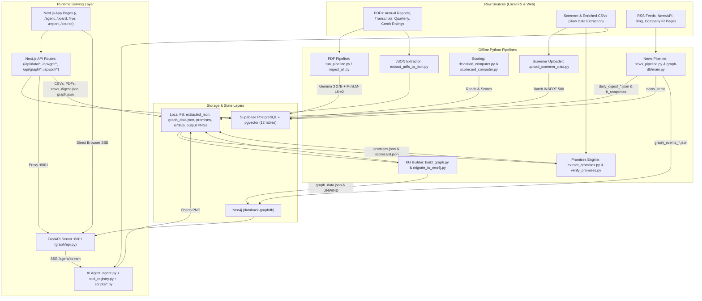
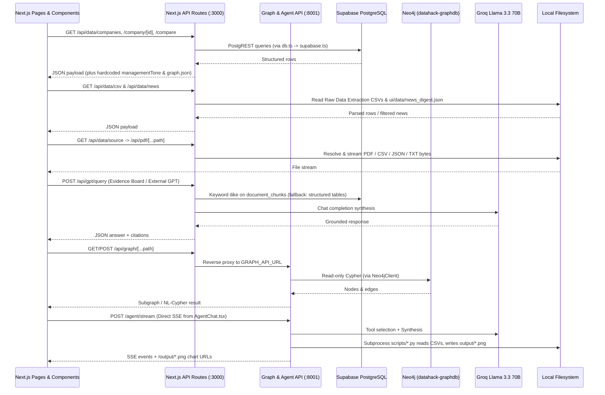
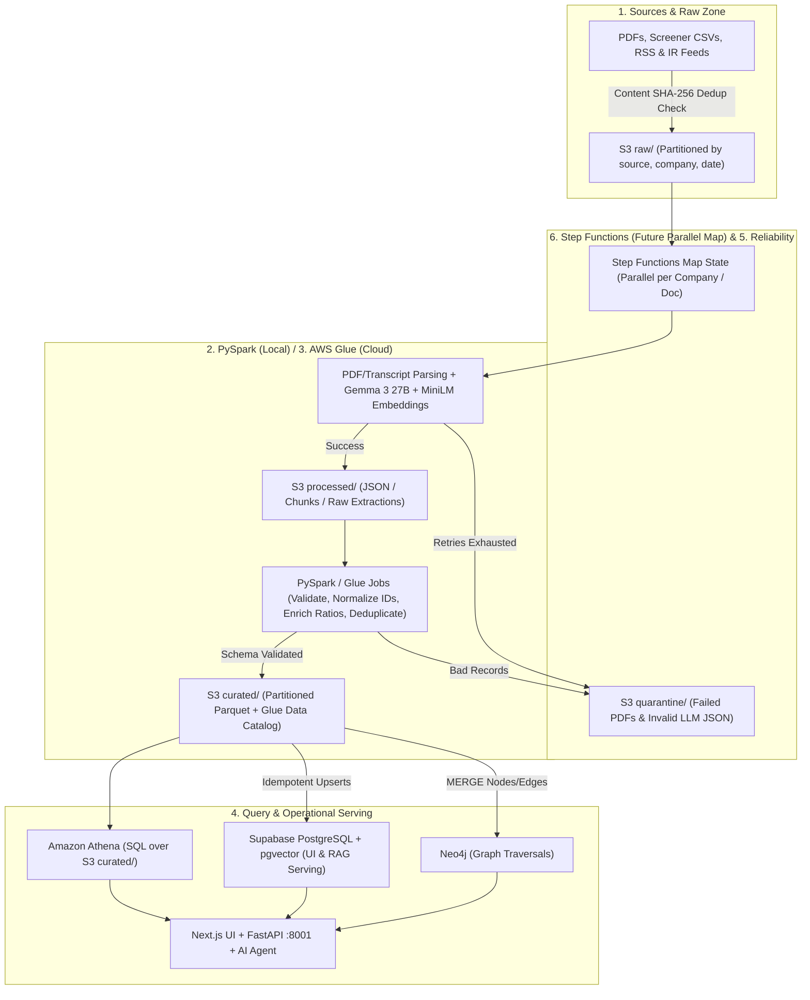

# EquityLens AI — End-to-End Architecture & Data Flow Audit

> **Scope & Purpose:** This document maps how **EquityLens AI** works in code today across every module, pipeline, database, and UI route, and bridges those findings to your upcoming AWS architecture upgrade (**S3**, **PySpark**, **AWS Glue**, **Amazon Athena**, **Reliability**, and **Step Functions**).

---

## Executive Summary

In its current state, EquityLens AI is **not a single monolithic pipeline**—it is **six loosely coupled batch/CLI pipelines** feeding **three persistence layers** (Supabase PostgreSQL + `pgvector`, Neo4j, and local filesystem JSON/CSV/PNG artifacts), served through **two runtime servers**:
1. A **Next.js 16 dashboard & API layer** ([ui/](file:///D:/Projects/equity-lens/ui)) on port `3000`/`3001`.
2. A **FastAPI Graph & Agent server** ([graph/api.py](file:///D:/Projects/equity-lens/graph/api.py)) on port `8001`.

> [!NOTE]
> **Intended PRD vs. Actual Codebase:** While [docs/overview/PRD.md](file:///D:/Projects/equity-lens/docs/overview/PRD.md) envisioned n8n workflows orchestrating 5 sub-agents solely over Supabase (`vector(768)` + `ITCHOTELS`), the actual codebase runs Python CLI scripts locally, uses `384`-dim embeddings (`all-MiniLM-L6-v2`), largely treats `JUNIPER` as the 5th company in active pipelines, uses Groq `llama-3.3-70b-versatile` for live agent/Q&A reasoning, and still relies heavily on local filesystem artifacts (`Raw Data Extraction/`, `ui/data/`, `output/`). Note also that `Raw Data Extraction/`, `data/files/`, and `output/` are external/gitignored runtime folders not committed in the git repository (see [.gitignore](file:///D:/Projects/equity-lens/.gitignore) and [misc/notes/dataset.txt](file:///D:/Projects/equity-lens/misc/notes/dataset.txt)).

### Current End-to-End System Flow

---

## 1. Components Inventory

### 1.1 Document & PDF Ingestion Subsystems

| Module / Path | Purpose & Key Symbols |
|---|---|
| [Data Ingestion/extract_pdfs_to_json.py](file:///D:/Projects/equity-lens/Data%20Ingestion/extract_pdfs_to_json.py) | Extracts plain-text paragraphs from PDFs while excluding tables (`pdfplumber` bbox overlap + numeric-line heuristic). Key functions: `extract_period_from_filename()`, `get_table_bboxes()`, `extract_pdf_to_json()`, `process_company()`. |
| [Data Ingestion/extracted_json/](file:///D:/Projects/equity-lens/Data%20Ingestion/extracted_json/IHCL/annual_report.json) | Pre-extracted JSON corpus across 5 folders (`CHALET`, `EIH`, `IHCL`, `ITCHOTELS`, `LEMONTREE`), each with `announcement.json`, `annual_report.json`, `credit_rating.json`, `quarterly_results.json`. |
| [pdf extraction pipeline/config.py](file:///D:/Projects/equity-lens/pdf%20extraction%20pipeline/config.py) | Central configuration: Featherless URL (`https://api.featherless.ai/v1`), `GEMMA_MODEL` (`google/gemma-3-27b-it`), `EMBEDDING_MODEL` (`all-MiniLM-L6-v2`, 384-dim), chunking (`3000` chars / `400` overlap), `COMPANIES`, speaker/section filters. |
| [pdf extraction pipeline/schema.sql](file:///D:/Projects/equity-lens/pdf%20extraction%20pipeline/schema.sql) | Supabase PostgreSQL + `pgvector` DDL defining 11 core tables, seeded `companies` rows (`ITCHOTELS` instead of `JUNIPER`), and `match_documents(vector(384), ...)` RPC. |
| [pdf extraction pipeline/pdf_extractor.py](file:///D:/Projects/equity-lens/pdf%20extraction%20pipeline/pdf_extractor.py) | Annual Report PDF parser & chunker (`process_annual_report()`, `is_high_value_page()`, `chunk_text()`). Defines `extract_toc()` & `extract_tables_from_page()` (currently bypassed in `process_annual_report()`). |
| [pdf extraction pipeline/transcript_parser.py](file:///D:/Projects/equity-lens/pdf%20extraction%20pipeline/transcript_parser.py) | Earnings call PDF parser (`process_transcript()`, `extract_speaker_blocks()`, `build_page_char_index()`). Separates management speakers from analysts/moderators and maps character offsets back to PDF pages. |
| [pdf extraction pipeline/gemma_extractor.py](file:///D:/Projects/equity-lens/pdf%20extraction%20pipeline/gemma_extractor.py) | Pre-filters chunks (`is_high_signal_chunk()`), calls Gemma 3 27B-IT in 5-chunk batches (`process_one_batch()`, `call_gemma()`), validates JSON, and inserts rows into 5 Supabase tables (`route_to_supabase()`). |
| [pdf extraction pipeline/embedder.py](file:///D:/Projects/equity-lens/pdf%20extraction%20pipeline/embedder.py) | Encodes chunks locally with `all-MiniLM-L6-v2` (`embed_and_store_chunks()`) and batch-inserts into `document_chunks`; also provides `embed_query()` and `search_similar_chunks()` via `match_documents` RPC. |
| [pdf extraction pipeline/run_pipeline.py](file:///D:/Projects/equity-lens/pdf%20extraction%20pipeline/run_pipeline.py) | Single-PDF CLI orchestrator (`run_annual_report()`, `run_transcript()`). Registers/updates `documents` table and runs extraction -> Gemma -> embeddings sequentially. |
| [pdf extraction pipeline/ingest_all.py](file:///D:/Projects/equity-lens/pdf%20extraction%20pipeline/ingest_all.py) | Master batch ingestion CLI across all 5 companies (`process_company_transcripts()` for `Call_Transcripts_JSON/*.json`, `process_company_annual_reports()` for `Annual_Reports/*.pdf`). |
| [pdf extraction pipeline/deviation_computer.py](file:///D:/Projects/equity-lens/pdf%20extraction%20pipeline/deviation_computer.py) | "Said vs Delivered" comparator (`compute_deviations_for_company()`, `compute_credibility_score()`). Matches `guidance_claims` vs `financials` (`BEAT`/`MISS`/`IN-LINE`) and aggregates `credibility_scores`. |
| [pdf extraction pipeline/scorecard_computer.py](file:///D:/Projects/equity-lens/pdf%20extraction%20pipeline/scorecard_computer.py) | 5-dimension analytical engine (`compute_scorecard()`): Industry Position, Financial Quality, Management Credibility + Truthfulness, Risk Flags, and 3x3 Stress Test Resilience, plus peer normalization and forward risk. |
| [pdf extraction pipeline/seed_guidance_data.py](file:///D:/Projects/equity-lens/pdf%20extraction%20pipeline/seed_guidance_data.py) | Standalone seed script that wipes and inserts 11 hardcoded `guidance_claims` and 7 `risk_flags` rows. |

### 1.2 Knowledge Graph & News Event Subsystems

| Module / Path | Purpose & Key Symbols |
|---|---|
| [graph/text_preprocessor.py](file:///D:/Projects/equity-lens/graph/text_preprocessor.py) | Loads and cleans `Data Ingestion/extracted_json/<CODE>/*.json` and `Call_Transcripts_JSON/*.json` (`load_all_data()`, `load_all_company_data()`), filtering boilerplate and short text. |
| [graph/entity_extractor.py](file:///D:/Projects/equity-lens/graph/entity_extractor.py) | Dictionary & regex NER (`extract_entities_from_chunk()`, `extract_cooccurrences()`, `get_recency_score()`) across `TOPIC`, `BRAND`, `LOCATION`, `STRATEGY`, `TIME_PERIOD`, `PERSON`, `COMPANY`, and `METRIC`. |
| [graph/build_graph.py](file:///D:/Projects/equity-lens/graph/build_graph.py) | Builds co-occurrence NetworkX graph (`build_graph()`), filters nodes/edges (`weight >= 0.3`), and writes [graph/graph_data.json](file:///D:/Projects/equity-lens/graph/graph_data.json) (554 nodes, 14,970 edges, ~8.75 MB). |
| [graph/migrate_to_neo4j.py](file:///D:/Projects/equity-lens/graph/migrate_to_neo4j.py) | Loads `graph_data.json` into Neo4j in 500-item `UNWIND` batches (`migrate_nodes()`, `migrate_edges()`, `create_constraints()`). |
| [graph/neo4j_client.py](file:///D:/Projects/equity-lens/graph/neo4j_client.py) | Synchronous Neo4j driver wrapper `Neo4jClient` (`search_nodes`, `get_node_neighbors`, `get_company_subgraph`, `get_company_profile`, `compare_companies`, `find_connections`, `get_stats`, `get_schema`). |
| [graph/graph_analyzer.py](file:///D:/Projects/equity-lens/graph/graph_analyzer.py) | Offline NetworkX CLI/library querying `graph_data.json` (`compare_companies`, `get_topic_leaders`, `find_connections`, `get_graph_summary`). |
| [graph/api.py](file:///D:/Projects/equity-lens/graph/api.py) | FastAPI server on port `8001` (`Knowledge Graph API v1.0.0`). Exposes 8 Neo4j graph endpoints (including `POST /query` NL-to-Cypher via Groq), `POST /agent/stream` (SSE), and static `/output` mount. Started via [graph/start_graph_api.sh](file:///D:/Projects/equity-lens/graph/start_graph_api.sh). |
| [graph-db/main.py](file:///D:/Projects/equity-lens/graph-db/main.py) | Idempotent Neo4j importer (`run_import()`, `UPSERT_QUERY`) ingesting news `graph_events_*.json` (matching [graph-db/test.json](file:///D:/Projects/equity-lens/graph-db/test.json) schema) into `:Event`, `:Company`, `:Source`, `:SourceBucket`, `:Dimension`, `:Metric`, `:Topic`. |

### 1.3 Promises ("Said vs Done") & Daily News Subsystems

| Module / Path | Purpose & Key Symbols |
|---|---|
| [promises/extract_promises.py](file:///D:/Projects/equity-lens/promises/extract_promises.py) | Deterministic regex/NLP extractor (`extract_promises()`, `iter_promises()`) scanning management chunks from `graph.text_preprocessor.load_all_data()` for measurable targets (`Revenue`, `EBITDA Margin`, `Net Profit`, `Debt`) and writing [promises/promises.json](file:///D:/Projects/equity-lens/promises/promises.json). |
| [promises/verify_promises.py](file:///D:/Projects/equity-lens/promises/verify_promises.py) | Verifies `promises.json` against local enriched CSVs (`agent.data_loader`) (`verify_promises()`, `classify()` into `EXCEEDED`/`KEPT`/`PARTIAL`/`BROKEN`/`PENDING`) and writes [promises/promise_scorecard.json](file:///D:/Projects/equity-lens/promises/promise_scorecard.json). |
| [promises/promise_report.py](file:///D:/Projects/equity-lens/promises/promise_report.py) | Renders a 3-panel matplotlib credibility scorecard chart (`credibility_scorecard.png`) from `promise_scorecard.json`. |
| [worflow_news/news_pipeline.py](file:///D:/Projects/equity-lens/worflow_news/news_pipeline.py) | Daily news collector (`run_pipeline()`): executes 12 collectors (Google Alerts RSS, publisher RSS, NewsAPI, Bing, IR page HTML hashes against [worflow_news/.state/ir_snapshots.json](file:///D:/Projects/equity-lens/worflow_news/.state/ir_snapshots.json), fallback BS4 scrape), applies 3-stage dedup + PRD classifier + evidence gate, writes `daily_digest_*.json/.md` and `pipeline_health_*.json`. |
| [worflow_news/upload_news_to_supabase.py](file:///D:/Projects/equity-lens/worflow_news/upload_news_to_supabase.py) | Reads latest `daily_digest_*.json` and uploads items to Supabase `news_items` (`create_news_table()`, `upload_digest()`). |

### 1.4 AI Financial Agent & Quantitative Scripts

| Module / Path | Purpose & Key Symbols |
|---|---|
| [agent/agent.py](file:///D:/Projects/equity-lens/agent/agent.py) | CLI & SSE streaming orchestrator (`process_query()`, `process_query_stream()`, `main()`). Runs 1 tool-selection LLM call -> 1 tool subprocess -> 1 synthesis LLM call. |
| [agent/llm_client.py](file:///D:/Projects/equity-lens/agent/llm_client.py) | Blocking HTTP client (`chat_completion()`, `groq_chat_completion()`, `parse_json_response()`). Primary: Groq `llama-3.3-70b-versatile`; fallback (only if `GROQ_API_KEY` is unset): OpenRouter `nvidia/nemotron-3-super-120b-a12b:free`. |
| [agent/prompts.py](file:///D:/Projects/equity-lens/agent/prompts.py) | Builds system prompt (`get_system_prompt()`) with CSV schemas, static Neo4j descriptive context, 7 `TOOL_SCHEMAS`, and `get_synthesis_prompt()`. |
| [agent/tool_registry.py](file:///D:/Projects/equity-lens/agent/tool_registry.py) | Dispatches 7 tool names (`execute_tool()`) to `scripts/*.py` via `subprocess.run` (`_run_script()`), or runs `run_custom_analysis()` via temporary `output/_custom_analysis.py`. |
| [agent/data_loader.py](file:///D:/Projects/equity-lens/agent/data_loader.py) | Local CSV loader & fuzzy metric/company matcher (`load_company_data()`, `load_all_companies()`, `fuzzy_match_metric()`), reading `Raw Data Extraction/<Company>/*.csv`. |
| [agent/chart_engine.py](file:///D:/Projects/equity-lens/agent/chart_engine.py) | Dark-theme headless Matplotlib chart generator (`grouped_bar_chart`, `line_chart`, `radar_chart`, `heatmap_chart`, `single_bar_chart`, `multi_line_chart`) saving PNGs to `output/`. |
| [scripts/compare_companies.py](file:///D:/Projects/equity-lens/scripts/compare_companies.py), [compare_quarters.py](file:///D:/Projects/equity-lens/scripts/compare_quarters.py), [financial_health.py](file:///D:/Projects/equity-lens/scripts/financial_health.py), [ratio_deep_dive.py](file:///D:/Projects/equity-lens/scripts/ratio_deep_dive.py), [sector_benchmark.py](file:///D:/Projects/equity-lens/scripts/sector_benchmark.py), [trend_analysis.py](file:///D:/Projects/equity-lens/scripts/trend_analysis.py) | Six CLI analytical tools invoked by `tool_registry.py`. Each loads CSVs via `agent.data_loader`, generates PNG charts via `agent.chart_engine`, and prints JSON to `stdout`. |
| [scripts/organize_docs.py](file:///D:/Projects/equity-lens/scripts/organize_docs.py) | File utility flattening `Raw Data Extraction/<CompanyFolder>/...` into `data/files/<COMPANY>_<Subfolder>_<Filename>`. |

### 1.5 Next.js UI & API Layer (`ui/`)

| Layer / File | Purpose & Key Symbols |
|---|---|
| **Pages (`ui/src/app/`)** | [page.tsx](file:///D:/Projects/equity-lens/ui/src/app/page.tsx) (main dashboard), [agent/page.tsx](file:///D:/Projects/equity-lens/ui/src/app/agent/page.tsx) (agent workspace), [board/page.tsx](file:///D:/Projects/equity-lens/ui/src/app/board/page.tsx) (ReactFlow evidence board), [live/page.tsx](file:///D:/Projects/equity-lens/ui/src/app/live/page.tsx) (simulated earnings call detector—no API calls), [report/page.tsx](file:///D:/Projects/equity-lens/ui/src/app/report/page.tsx) (printable report), [source/page.tsx](file:///D:/Projects/equity-lens/ui/src/app/source/page.tsx) (PDF/CSV citation viewer). |
| **Libraries (`ui/src/lib/`)** | [supabase.ts](file:///D:/Projects/equity-lens/ui/src/lib/supabase.ts) (`getServiceClient()`), [db.ts](file:///D:/Projects/equity-lens/ui/src/lib/db.ts) (Supabase queries, hardcoded `getManagementTone()`, local `getGraph()`, FS `resolveSource()`), [csv-parser.ts](file:///D:/Projects/equity-lens/ui/src/lib/csv-parser.ts) (FS CSV parser), [hooks.ts](file:///D:/Projects/equity-lens/ui/src/lib/hooks.ts) (React fetch hooks), [transforms.ts](file:///D:/Projects/equity-lens/ui/src/lib/transforms.ts) (snake_case to camelCase adapters), [data.ts](file:///D:/Projects/equity-lens/ui/src/lib/data.ts) (empty deprecated stub). |
| **Data APIs (`ui/src/app/api/data/`)** | [companies/route.ts](file:///D:/Projects/equity-lens/ui/src/app/api/data/companies/route.ts), [company/[id]/route.ts](file:///D:/Projects/equity-lens/ui/src/app/api/data/company/%5Bid%5D/route.ts), [compare/route.ts](file:///D:/Projects/equity-lens/ui/src/app/api/data/compare/route.ts), [csv/route.ts](file:///D:/Projects/equity-lens/ui/src/app/api/data/csv/route.ts), [news/route.ts](file:///D:/Projects/equity-lens/ui/src/app/api/data/news/route.ts), [source/route.ts](file:///D:/Projects/equity-lens/ui/src/app/api/data/source/route.ts). |
| **GPT / RAG APIs (`ui/src/app/api/gpt/`)** | [company/[id]/route.ts](file:///D:/Projects/equity-lens/ui/src/app/api/gpt/company/%5Bid%5D/route.ts), [compare/route.ts](file:///D:/Projects/equity-lens/ui/src/app/api/gpt/compare/route.ts), [guidance/[id]/route.ts](file:///D:/Projects/equity-lens/ui/src/app/api/gpt/guidance/%5Bid%5D/route.ts), [query/route.ts](file:///D:/Projects/equity-lens/ui/src/app/api/gpt/query/route.ts) (exposed via [ui/public/openapi.json](file:///D:/Projects/equity-lens/ui/public/openapi.json)). |
| **Proxy & File APIs** | [api/graph/[...path]/route.ts](file:///D:/Projects/equity-lens/ui/src/app/api/graph/%5B...path%5D/route.ts) (proxies to `GRAPH_API_URL`, default `http://localhost:8001`), [api/pdf/[...path]/route.ts](file:///D:/Projects/equity-lens/ui/src/app/api/pdf/%5B...path%5D/route.ts) (streams local `.pdf`/`.csv`/`.json`/`.txt`). |
| **UI Seed Scripts & Static JSONs** | [ui/scripts/generate-json.mjs](file:///D:/Projects/equity-lens/ui/scripts/generate-json.mjs) & [add_missing_metrics.js](file:///D:/Projects/equity-lens/ui/scripts/add_missing_metrics.js) build static JSONs in `ui/data/`. At runtime, **only** [ui/data/news_digest.json](file:///D:/Projects/equity-lens/ui/data/news_digest.json) and [ui/data/graph.json](file:///D:/Projects/equity-lens/ui/data/graph.json) are read; the other 8 JSONs (`companies.json`, `financials.json`, `scorecards.json`, `guidance_claims.json`, `deviation_tracker.json`, `risk_flags.json`, `credibility_scores.json`, `management_tone.json`) are legacy/unused at runtime. |

### 1.6 Miscellaneous / Prototype Scripts & Reference Assets

| Module / Path | Purpose |
|---|---|
| [misc/data-gathering/upload_screener_data.py](file:///D:/Projects/equity-lens/misc/data-gathering/upload_screener_data.py) | Bulk-loads Screener.in CSVs (`profit_loss.csv`, `balance_sheet.csv`, `Quarter_Analysis_Table.csv`) into Supabase `financials` & `companies`. |
| [misc/data_formatter/app.py](file:///D:/Projects/equity-lens/misc/data_formatter/app.py), [data_formatter_local.py](file:///D:/Projects/equity-lens/misc/data_formatter/data_formatter_local.py), [ingest_engine.py](file:///D:/Projects/equity-lens/misc/data_formatter/ingest_engine.py) | Early EIH-specific prototypes using local Ollama (`llama3.2:3b`) or Featherless Gemma to insert into Supabase. |
| [misc/one-offs/extract.py](file:///D:/Projects/equity-lens/misc/one-offs/extract.py), [run.py](file:///D:/Projects/equity-lens/misc/one-offs/run.py) | Single-file IHCL test scripts (`extract.py` calls Groq `llama-3.1-8b-instant` -> [IHCL_FY24_extracted.json](file:///D:/Projects/equity-lens/pdf%20extraction%20pipeline/IHCL_FY24_extracted.json); `run.py` wraps `pdf_extractor` + `gemma_extractor`). |
| [governance/hotel_companies_governance.pdf](file:///D:/Projects/equity-lens/governance/hotel_companies_governance.pdf) & [docs/](file:///D:/Projects/equity-lens/docs/overview/PRD.md) | Sector governance report, PRD, graph migration docs, UI specs, and Supabase setup notes. |

---

## 2. Execution Flow

### Flow A — PDF & Transcript Ingestion -> Deviations -> Scorecards
1. **Single PDF ([run_pipeline.py](file:///D:/Projects/equity-lens/pdf%20extraction%20pipeline/run_pipeline.py))**:
   `main()` -> `register_document()` (upsert `documents`) ->
   - Annual/Quarterly/Presentation: `pdf_extractor.process_annual_report()` -> `gemma_extractor.process_annual_report_chunks()` -> `embedder.embed_and_store_chunks()` -> `update_document_status()`
   - Transcript: `transcript_parser.process_transcript()` -> `gemma_extractor.process_transcript_chunks()` -> `embedder.embed_and_store_chunks()` -> `update_document_status()`
2. **Batch Corpus ([ingest_all.py](file:///D:/Projects/equity-lens/pdf%20extraction%20pipeline/ingest_all.py))**:
   `main()` loops over `COMPANIES` -> `process_company_transcripts()` (`json_transcript_to_chunks()` -> `process_transcript_chunks()` -> `embed_and_store_chunks()`) -> `process_company_annual_reports()` (`process_annual_report()` -> `process_annual_report_chunks()` -> `embed_and_store_chunks()`). *(Does not touch `documents` table.)*
3. **Seed Fallback ([seed_guidance_data.py](file:///D:/Projects/equity-lens/pdf%20extraction%20pipeline/seed_guidance_data.py))**:
   `main()` -> deletes all rows from `guidance_claims` & `risk_flags` -> inserts 11 guidance + 7 risk seed rows.
4. **Deviations & Credibility ([deviation_computer.py](file:///D:/Projects/equity-lens/pdf%20extraction%20pipeline/deviation_computer.py))**:
   `main()` loops per company -> `compute_deviations_for_company()` (reads `guidance_claims` + `financials`, computes deltas, inserts `deviation_tracker`) -> `compute_credibility_score()` (reads `deviation_tracker`, upserts `credibility_scores`).
5. **Composite Scorecard ([scorecard_computer.py](file:///D:/Projects/equity-lens/pdf%20extraction%20pipeline/scorecard_computer.py))**:
   `main()` loops per company -> `compute_scorecard()` (reads `credibility_scores`, `financials`, `risk_flags`, `deviation_tracker`, `guidance_claims`, `document_chunks` count -> computes 5 dimensions + `compute_peer_normalization()` + `compute_forward_risk()` + `compute_uncertainty_band()` -> upserts `scorecards`).

### Flow B — Screener CSVs & AI Financial Agent
1. **Screener Bulk Load ([upload_screener_data.py](file:///D:/Projects/equity-lens/misc/data-gathering/upload_screener_data.py))**:
   `main()` -> `ensure_companies_exist()` -> deletes `deviation_tracker` then `financials` -> loops over 5 companies -> `upload_financials()` reads 3 CSVs per company -> batch inserts (`500` rows) into `financials`.
2. **Agent Request ([agent/agent.py](file:///D:/Projects/equity-lens/agent/agent.py))**:
   Invoked via CLI (`main()`) or FastAPI SSE (`POST /agent/stream` -> `process_query_stream()`):
   - Builds prompt via `prompts.get_system_prompt()`.
   - Calls `llm_client.chat_completion(json_mode=True)` (Groq `llama-3.3-70b-versatile`) to select `{tool, args, thought}`.
   - Calls `tool_registry.execute_tool()` -> spawns `subprocess.run([python, scripts/<tool>.py, ...])` -> script loads local CSVs via `data_loader.py` & writes PNGs via `chart_engine.py`, printing JSON to `stdout`.
   - Calls `llm_client.chat_completion()` with `prompts.get_synthesis_prompt()` -> yields final markdown narrative + `output/*.png` chart paths.

### Flow C — Knowledge Graph Build -> Neo4j -> FastAPI
1. `Data Ingestion/extract_pdfs_to_json.py`: `main()` -> `process_company()` -> writes `extracted_json/<ID>/<doc_type>.json`.
2. `graph/build_graph.py`: `build_graph()` -> `text_preprocessor.load_all_data()` -> loops chunks calling `entity_extractor.extract_entities_from_chunk()` + `extract_cooccurrences()` + `get_recency_score()` -> filters nodes/edges -> writes `graph/graph_data.json`.
3. `graph/migrate_to_neo4j.py`: `main()` -> `load_graph_json()` -> `create_constraints()` -> `migrate_nodes()` -> `migrate_edges()` -> `verify_migration()` (writes to Neo4j `datahack-graphdb`).
4. `graph/api.py`: FastAPI startup initializes global `Neo4jClient` -> handles `/search`, `/node/{id}/neighbors`, `/company/{code}/subgraph`, `/company/{code}/profile`, `/compare`, `/schema`, `/stats`, `POST /query` (Groq NL-to-Cypher -> read-only guard -> `_run_query()`), and `POST /agent/stream`.

### Flow D — Management Promises ("Said vs Done")
1. `promises/extract_promises.py`: `extract_promises()` -> `graph.text_preprocessor.load_all_data()` -> `iter_promises()` -> atomic write to `promises/promises.json`.
2. `promises/verify_promises.py`: `verify_promises()` -> `read_promises()` -> per promise, `agent.data_loader.load_company_data()` -> `choose_window_actual()` -> `classify()` -> `aggregate()` -> atomic write to `promises/promise_scorecard.json`.
3. `promises/promise_report.py`: `generate_promise_charts()` -> reads `promise_scorecard.json` -> writes `credibility_scorecard.png`.

### Flow E — Daily News & Event Graph
1. `worflow_news/news_pipeline.py`: `run_pipeline()` -> runs 12 sequential source collectors (updating `.state/ir_snapshots.json`) -> `enrich_and_filter()` -> `deduplicate()` -> `enforce_evidence_gate()` -> `build_digest()` -> writes `daily_digest_<date>.json`, `.md`, and `pipeline_health_<date>.json`.
2. `worflow_news/upload_news_to_supabase.py`: `main()` -> `create_news_table()` -> `load_latest_digest()` -> `upload_digest()` (deletes existing rows for `digest_date`, inserts row-by-row into Supabase `news_items`).
3. `graph-db/main.py`: `run_import()` -> loads `graph_events_*.json` -> creates constraints -> single `UNWIND $events` `UPSERT_QUERY` into Neo4j.

### Flow F — Runtime UI & API Serving Flow

---

## 3. Data Flow (Formats, Transformations & Storage Writes)

### 3.1 File Artifacts & Directory Contracts

| Artifact / Folder | Format | Producer | Consumer |
|---|---|---|---|
| `Raw Data Extraction/<Company>/` | PDFs, `Call_Transcripts_JSON/*.json`, Screener CSVs (`profit_loss*.csv`, `balance_sheet*.csv`, `Quarter_Analysis_Table.csv`, `*_enriched.csv`, `cross_metrics.csv`) | External / Screener / Feature Eng. | `ingest_all.py`, `upload_screener_data.py`, `agent/data_loader.py`, `promises/verify_promises.py`, `ui/lib/csv-parser.ts`, `ui/api/pdf` |
| `data/files/` | Flattened PDFs/CSVs (`<CODE>_<Subfolder>_<Filename>`) | `scripts/organize_docs.py` | `ui/src/lib/db.ts:resolveSource()` + `ui/api/pdf` |
| `Data Ingestion/extracted_json/<ID>/*.json` | JSON array of `{source_file, company_id, document_type, period, pages[{page_number, paragraphs[]}]}` | `extract_pdfs_to_json.py` | `graph/text_preprocessor.py` |
| `graph/graph_data.json` | JSON `{nodes[], edges[], stats}` (~8.75 MB) | `graph/build_graph.py` | `graph/migrate_to_neo4j.py`, `graph/graph_analyzer.py` |
| `promises/promises.json` | JSON array of `{id, company, source_period, target_period, target_value{low,high,unit,comparator}, direction, ...}` | `promises/extract_promises.py` | `promises/verify_promises.py` |
| `promises/promise_scorecard.json` | JSON `{summary: {company_scores...}, details[]}` | `promises/verify_promises.py` | `promises/promise_report.py` |
| `worflow_news/output/daily_digest_*.json` | JSON `{market_context, companies{}, sector_news[], global_hospitality_news[], metadata}` | `worflow_news/news_pipeline.py` | `upload_news_to_supabase.py` *(schema mismatch noted in §6)* |
| `worflow_news/.state/ir_snapshots.json` | JSON dict `{ "COMPANY\|URL": {hash, last_seen_utc, url, company} }` | `worflow_news/news_pipeline.py` | `worflow_news/news_pipeline.py` |
| `ui/data/*.json` | Legacy seed JSONs + runtime `news_digest.json` (41.8 KB) & `graph.json` (2.7 KB) | `ui/scripts/generate-json.mjs`, `add_missing_metrics.js` | Runtime: only `news_digest.json` & `graph.json` |
| `output/*.png` & `credibility_scorecard.png` | 150 DPI dark-theme Matplotlib PNG charts | `agent/chart_engine.py`, `promises/promise_report.py` | `graph/api.py` static `/output` -> `AgentChat.tsx` |

### 3.2 Supabase PostgreSQL Table Matrix

| Table / RPC | Writer(s) & Write Mode | Reader(s) | Notes |
|---|---|---|---|
| `companies` | `schema.sql` (`ON CONFLICT DO NOTHING`), `upload_screener_data.py` (`UPSERT` on `id`) | `ui/lib/db.ts` (`/api/data/companies`, `/compare`, `/gpt/compare`) | Seeded with `ITCHOTELS` in `schema.sql` vs `JUNIPER` in `upload_screener_data.py`. |
| `documents` | `run_pipeline.py` (`UPSERT` on `company_id,document_name`, then `UPDATE` status/counts) | None in runtime UI | `ingest_all.py` bypasses this registry table. |
| `financials` | `upload_screener_data.py` (`DELETE ALL` + batch `INSERT 500`), `gemma_extractor.py` (row `INSERT`), `misc/data_formatter/*` (row `INSERT`) | `deviation_computer.py`, `scorecard_computer.py`, `ui/lib/db.ts` | Holds Screener annual/quarterly rows + Gemma extractions. |
| `guidance_claims` | `gemma_extractor.py` (row `INSERT`), `seed_guidance_data.py` (`DELETE ALL` + row `INSERT`), `misc/data_formatter/*` (row `INSERT`) | `deviation_computer.py`, `scorecard_computer.py`, `ui/lib/db.ts` | Forward-looking quotes & numeric bounds. |
| `deviation_tracker` | `deviation_computer.py` (row `INSERT` — **non-idempotent**); cleared by `upload_screener_data.py` | `deviation_computer.py`, `scorecard_computer.py`, `ui/lib/db.ts`, `/api/gpt/query` fallback | Joins `guidance_claims` with `financials`. |
| `risk_flags` | `gemma_extractor.py` (row `INSERT`), `seed_guidance_data.py` (`DELETE ALL` + row `INSERT`), `misc/data_formatter/*` | `scorecard_computer.py`, `ui/lib/db.ts` | 9 allowed categories (`debt`, `governance`, etc.). |
| `raw_data` | `gemma_extractor.py` (row `INSERT`), `misc/data_formatter/*` | None in runtime UI | Catch-all extraction table. |
| `credibility_scores` | `deviation_computer.py` (`UPSERT` on `company_id,period`, `period="ALL"`) | `scorecard_computer.py`, `ui/lib/db.ts`, `/api/gpt/query` fallback | 0–100 score + 6 check sub-scores + trend. |
| `scorecards` | `scorecard_computer.py` (`UPSERT` on `company_id,period`) | `ui/lib/db.ts`, `/api/gpt/query` fallback | Stores 4 scalar dim columns + rich `evidence_summary` JSONB. |
| `document_chunks` | `embedder.py` (batch `INSERT 50` with `vector(384)`) | `embedder.py:search_similar_chunks()` (RPC), `/api/gpt/query` (keyword `ilike`) | `schema.sql` uses `vector(384)` for `all-MiniLM-L6-v2` (PRD said 768). |
| `credit_ratings` | `gemma_extractor.py` (row `INSERT`), `misc/data_formatter/*` | None in runtime UI | Agency ratings & rationale. |
| `news_items` | `upload_news_to_supabase.py` (`DELETE` by `digest_date` + row `INSERT`) | None in runtime UI (`/api/data/news` reads local `news_digest.json`) | Created via `exec_sql` RPC or manual DDL. |
| `match_documents` (RPC) | `schema.sql` | `embedder.py:search_similar_chunks()` | Unused by Next.js `/api/gpt/query` (which uses `ilike`). |

### 3.3 Neo4j Graph Schemas (`datahack-graphdb`)

1. **Co-occurrence Knowledge Graph (`graph/migrate_to_neo4j.py`)**:
   - **Nodes**: `:Company {code, name, count, companies}` (unique `code`), plus `:TOPIC`, `:BRAND`, `:LOCATION`, `:STRATEGY`, `:PERSON`, `:TIME_PERIOD` with `{name, count, companies[], num_companies}`.
   - **Edges**: `-[:CO_OCCURS {weight, count, companies[], contexts[]}]->` between entities appearing in the same text chunk.
2. **News Event Graph (`graph-db/main.py`)**:
   - **Nodes**: `:Event {event_id, title, summary, url, published_date, as_of_date, event_type, sentiment, market_scope, relevance_score, graph_confidence, quality, ...}` (unique `event_id`), `:Company {code}` (unique `code`), `:Source {name}` (unique `name`), `:SourceBucket {name}`, `:Dimension {name}`, `:Metric {name}`, `:Topic {name}`.
   - **Edges**: `(:Event)-[:FROM_SOURCE]->(:Source)`, `(:Event)-[:IN_SOURCE_BUCKET]->(:SourceBucket)`, `(:Event)-[:ALIGNS_WITH]->(:Dimension)`, `(:Company)-[:AFFECTED_BY]->(:Event)`, `(:Event)-[:IMPACTS_METRIC]->(:Metric)`, `(:Event)-[:TAGGED_AS]->(:Topic)`.

---

## 4. Dependency Matrix

| Subsystem | PostgreSQL / Supabase | `pgvector` + Embeddings | Neo4j (`datahack-graphdb`) | LLMs (Gemma / Groq / OpenRouter / Ollama) | PDF / HTML / Graph Libs | Local FS |
|---|---|---|---|---|---|---|
| **Data Ingestion (`extract_pdfs_to_json.py`)** | — | — | — | — | `PyMuPDF` (`fitz`), `pdfplumber` | Raw PDFs -> `extracted_json/` |
| **PDF Pipeline (`pdf_extractor`, `transcript_parser`, `gemma_extractor`, `embedder`)** | `supabase-py` (PostgREST) | `all-MiniLM-L6-v2` (384-dim, local `sentence-transformers`) -> `document_chunks` | — | **Gemma 3 27B-IT** via Featherless AI (`openai` SDK) | `pypdf`, `pdfplumber` | PDFs / Transcript JSONs |
| **Scoring (`deviation_computer`, `scorecard_computer`)** | `supabase-py` | Count query only on `document_chunks` | — | — | Stdlib (`statistics`) | — |
| **Knowledge Graph (`graph/`)** | `supabase` in `requirements.txt` (unused in code) | — | `neo4j>=5.14.0` (`bolt://127.0.0.1:7687`) | **Groq** `llama-3.3-70b-versatile` (NL->Cypher in `api.py`) | `networkx`, `fastapi`, `uvicorn` | `extracted_json/` <-> `graph_data.json` |
| **Event Graph (`graph-db/`)** | — | — | `neo4j` | — | Stdlib | `graph_events_*.json` |
| **Promises (`promises/`)** | — | — | — | — | `matplotlib`, `numpy` | `extracted_json/`, `Raw Data Extraction/`, `promises/*.json`, `.png` |
| **News (`worflow_news/`)** | `supabase-py` (`upload_news_to_supabase.py`) | — | `neo4j` in `requirements.txt` (unused) | — | `feedparser`, `beautifulsoup4`, `rapidfuzz`, `requests` | `.state/ir_snapshots.json`, `output/daily_digest_*` |
| **Agent & Scripts (`agent/`, `scripts/`)** | — *(None)* | — | — *(Prompt context only)* | **Groq** `llama-3.3-70b-versatile`; OpenRouter `nemotron-3-super-120b` fallback | `pandas`, `numpy`, `matplotlib` | `Raw Data Extraction/*.csv` -> `output/*.png` |
| **Next.js UI (`ui/`)** | `@supabase/supabase-js` *(Note: `pg` is NOT installed)* | Keyword `ilike` on `document_chunks` | Proxied via `GRAPH_API_URL` (`:8001`) | **Groq** `llama-3.3-70b-versatile` in `/api/gpt/query` | `recharts`, `reactflow`, `react-force-graph` | `ui/data/{news_digest,graph}.json`, `Raw Data Extraction/`, `data/files/` |
| **Misc (`misc/`)** | `supabase-py` (hardcoded URL/keys) | — | — | **Ollama** `llama3.2:3b`, **Featherless** Gemma, **Groq** `llama-3.1-8b-instant` | `PyPDF2`, `pypdf`, `streamlit`, `python-docx` | `Raw Data Extraction/`, `data/IHCL/ihcl.pdf` |

---

## 5. Parallelism, Concurrency & Synchronization

| Area | Current Concurrency Model | Batching, Caching & State | Retries, Dedup & Error Handling |
|---|---|---|---|
| **PDF & Gemma Ingestion** | **Effectively sequential.** `gemma_extractor.py` uses `ThreadPoolExecutor(max_workers=1)` to avoid Featherless rate limits; `ingest_all.py` and `run_pipeline.py` loop strictly sequentially across companies, files, and pages. | Gemma batch size = `5` chunks; `sentence-transformers` encode batch = `64`; Supabase insert batch = `50` (`embedder.py`); chunking = `3000` chars / `400` overlap. | `call_gemma()` retries `3x` with linear backoff (`2s`, `4s`). Per-batch/row `try/except` skips errors. **No deduplication** on inserts. |
| **Deviation & Scorecard** | **Strictly sequential** loops over companies and rows. | None (`scorecard_computer.py` re-queries all 4 peers on every company, creating `O(N^2)` DB traffic). | Per-row `try/except`. `deviation_tracker` uses raw `INSERT` (duplicates on re-run); `credibility_scores` & `scorecards` use `UPSERT`. |
| **Graph Build & Migration** | **Strictly sequential** chunk processing in `build_graph.py`. | `migrate_to_neo4j.py` batches `UNWIND` in chunks of `500` (attempts `CALL { ... } IN TRANSACTIONS OF 100 ROWS` for edges, with fallback). `graph-db/main.py` runs 1 `UNWIND` transaction. | `graph-db/main.py` is idempotent via `MERGE` + uniqueness constraints. `graph/api.py` runs blocking Neo4j/Groq/agent calls inside `async def` routes. |
| **Promises Pipeline** | **Strictly sequential.** | Atomic writes via `.tmp` + `os.replace()` (`write_json_atomic`). | Deterministic SHA-1 `promise_<12hex>` ID dedup in `promises.json`. |
| **News Pipeline** | **Strictly sequential** across 12 collectors and items. | State file `.state/ir_snapshots.json` stores SHA-1 hashes of IR pages to detect changes across runs. | `request_with_retry()` retries `3x` (`1.5 * attempt`s backoff) on exceptions & HTTP `>=500`. 3-stage dedup (URL+title hash, date+content hash, `rapidfuzz >= 92`). |
| **AI Agent & Scripts** | **Single-turn sequential** pipeline; spawns blocking `subprocess.run` (`60s` timeout for scripts, `30s` for custom analysis). | **No caching** in `agent/data_loader.py` (re-reads CSVs per subprocess). | `llm_client.py` retries `3x` (`2s` fixed / `2*(attempt+1)`s on 429). **Concurrency hazard:** `output/_custom_analysis.py` & `_find_latest_chart()` collide under parallel requests. |
| **Next.js UI & API** | **`Promise.all` fan-outs** on server: 8-way in `/api/data/company/[id]`, 5-way in `/api/gpt/company/[id]`, 3-way in `/api/gpt/query` fallback, 2-way in `/api/gpt/guidance/[id]` & initial `/api/gpt/compare`. **Sequential** `for` loops fetch `getLatestAnnualFinancials` per company in `/api/data/compare` & `/api/gpt/compare`. | Routes use `force-dynamic` (no route caching); `/api/pdf` sets `Cache-Control: max-age=3600` (except CSV); `db.ts` caches `data/files` directory listing in `_filesCache`; `supabase.ts` instantiates a stateless PostgREST client per call. | `/api/gpt/query` has graceful fallbacks (Groq fail -> raw chunk snippets; 0 chunks -> structured DB tables). Client hooks (`hooks.ts`) use raw `fetch` with no SWR/React Query cache. |

---

## 6. Code-Level Gaps & Gotchas Discovered (Fix Before / During AWS Upgrade)

1. **Company ID Mismatch (`ITCHOTELS` vs. `JUNIPER`)**:
   - `pdf extraction pipeline/schema.sql` and `Data Ingestion/extract_pdfs_to_json.py` (and `Data Ingestion/extracted_json/ITCHOTELS/`) map the 5th company to `ITCHOTELS`, whereas `config.py`, `ingest_all.py`, `deviation_computer.py`, `scorecard_computer.py`, `upload_screener_data.py`, `agent/`, and `ui/` use `JUNIPER` (`Juniper_Hotels`). Foreign keys on `ITCHOTELS` vs `JUNIPER` will silently fail or split data unless normalized.
2. **Non-Idempotent Raw `INSERT`s**:
   - `gemma_extractor.py`, `embedder.py`, `deviation_computer.py` (`deviation_tracker`), and `misc/data_formatter/*` append rows without deduplication or upserts. Re-running pipelines creates duplicate records, skewing hit rates, RAG retrieval, and scorecards.
3. **Hardcoded Windows Paths & Secrets**:
   - `Data Ingestion/extract_pdfs_to_json.py` hardcodes `c:\Users\91845\Desktop\DataHack4.0\the-big-leagues\...`.
   - `misc/data-gathering/upload_screener_data.py`, `misc/data_formatter/*.py`, and `misc/one-offs/extract.py` contain hardcoded Supabase `service_role` JWTs, Featherless API keys, Groq keys, and local paths.
4. **News Pipeline -> Supabase -> UI Disconnect**:
   - `worflow_news/news_pipeline.py` outputs keys `companies`, `sector_news`, and `global_hospitality_news`, whereas `upload_news_to_supabase.py` looks for `all_items`, `company_sections`, `sector_items`, and `global_items`—causing uploads from raw pipeline output to miss items.
   - Meanwhile, the Next.js UI (`/api/data/news`) ignores Supabase `news_items` entirely and reads static `ui/data/news_digest.json`.
5. **Neo4j Label Casing Mismatch**:
   - `graph/migrate_to_neo4j.py:migrate_nodes()` writes uppercase labels (`:TOPIC`, `:BRAND`, `:LOCATION`, `:STRATEGY`, `:PERSON`, `:TIME_PERIOD`), and `graph/api.py` instructs Groq to query uppercase labels—but `create_constraints()` and `neo4j_client.py` (`get_company_profile`, `compare_companies`) check PascalCase labels (`:Topic`, `:Brand`, etc.).
6. **Agent Isolated from Supabase/Neo4j & Unsafe Custom Tool Stub**:
   - `agent/` queries only local CSVs in `Raw Data Extraction/` (despite `prompts.py` describing the Neo4j graph).
   - `tool_registry.py:run_custom_analysis()` ignores the LLM's `analysis_plan` and runs a fixed summary snippet in `output/_custom_analysis.py`, creating a race condition under concurrent requests alongside `_find_latest_chart()`.
7. **`scorecard_computer.py` `O(N^2)` Peer Querying**:
   - Running `--company ALL` triggers full Supabase queries for all 4 peers inside each company's loop instead of fetching peer metrics once.
8. **`/api/pdf/[...path]` 403 Path Rejection**:
   - `ui/src/lib/db.ts:resolveSource()` can return relative paths pointing into `../Data Ingestion/extracted_json/...` or `../governance/...`, which `ui/src/app/api/pdf/[...path]/route.ts` rejects with `403 Access denied` because its security check only allows `../data/files` and `../Raw Data Extraction`.

---

## 7. Target AWS Architecture Alignment Preview

Mapping your 6 planned AWS capabilities onto the audited system reveals a clean **Medallion Data Lake + Serving Tier** architecture that keeps Supabase (interactive UI/pgvector) and Neo4j (graph traversals) as low-latency serving stores—or lets Athena serve analytical SQL directly:

| AWS Capability | Role in Upgraded EquityLens Architecture | Replaces / Upgrades |
|---|---|---|
| **1. S3 Data Lake (`raw/`, `processed/`, `curated/`)** | **Single source of truth for files & lakehouse tables:** - `s3://<bucket>/raw/`: Raw PDFs (`annual_reports/`, `transcripts/`, `quarterly/`, `credit_ratings/`), Screener CSVs, raw RSS/API news JSON snapshots. - `s3://<bucket>/processed/`: Cleaned/parsed text chunks (`extracted_json`), speaker blocks, normalized CSVs, raw LLM JSON extractions. - `s3://<bucket>/curated/`: Partitioned Parquet datasets (`company_id=.../period=...`) for `financials`, `guidance_claims`, `deviations`, `scorecards`, `promises`, `news_items`, `graph_entities`. | Replaces scattered local `Raw Data Extraction/`, `Data Ingestion/extracted_json/`, `ui/data/*.json`, and hardcoded local paths. Also serves source PDFs via presigned URLs instead of `/api/pdf` FS reads. |
| **2. PySpark (Local Transformations & Validation)** | Local Spark ETL modules mirroring AWS Glue logic: enforces strict schemas, normalizes company codes (`ITCHOTELS`/`JUNIPER` mapping), computes YoY/QoQ/DuPont/enriched metrics (replacing ad-hoc `csv-parser.ts` & pandas scripts), runs data quality assertions, and deduplicates records before writing Parquet. | Replaces `upload_screener_data.py`, `generate-json.mjs`, `text_preprocessor.py` cleaning, and local pandas metric enrichment. |
| **3. AWS Glue** | Runs the validated PySpark ETL jobs in the cloud (`raw/` -> `processed/` -> `curated/`) and uses **Glue Data Catalog** (+ Crawlers or explicit schema registration) to expose partitioned Parquet datasets as queryable tables. | Moves local batch ETL (`ingest_all.py`, `deviation_computer.py`, `scorecard_computer.py` analytics) to managed serverless Spark jobs. |
| **4. Amazon Athena** | Serverless SQL engine querying Glue Catalog tables in `s3://<bucket>/curated/`. Enables cross-company financial SQL, deviation trend queries, and agent SQL tool execution without loading local CSVs. | Gives `agent/` & `scripts/` a cloud SQL backend (`pyathena` / `boto3`) and enables ad-hoc equity analytics across historical filings. |
| **5. Reliability (Dedup, Retries, Failure Handling)** | - **Dedup:** Deterministic SHA-256 content & primary-key hashes (`doc_hash`, `chunk_id`, `event_id`, `claim_id`) + S3 ingestion manifest / DynamoDB or Parquet merge/upsert. - **Retries:** Exponential backoff + jitter for Featherless/Groq/RSS calls. - **Failure Handling:** Dead-letter/quarantine prefix (`s3://<bucket>/quarantine/`) for malformed PDFs or invalid LLM JSON + structured run logs. | Fixes duplicate `INSERT` bugs in `gemma_extractor.py`, `embedder.py`, `deviation_computer.py`, and missing retries/DLQs. |
| **6. AWS Step Functions (Phase 2 Parallelism)** | Orchestrates per-company & per-document `Map` states to run PDF parsing, Gemma extraction, embedding generation, and news collection in parallel, followed by a synchronization barrier that triggers Glue curated transforms, deviation/scorecard scoring, and Supabase/Neo4j sync. | Replaces sequential single-threaded Python loops (`MAX_WORKERS=1`) and manual script chaining. |

### Proposed AWS-Augmented Flow

