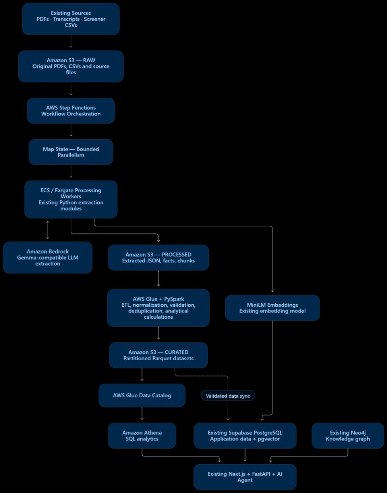
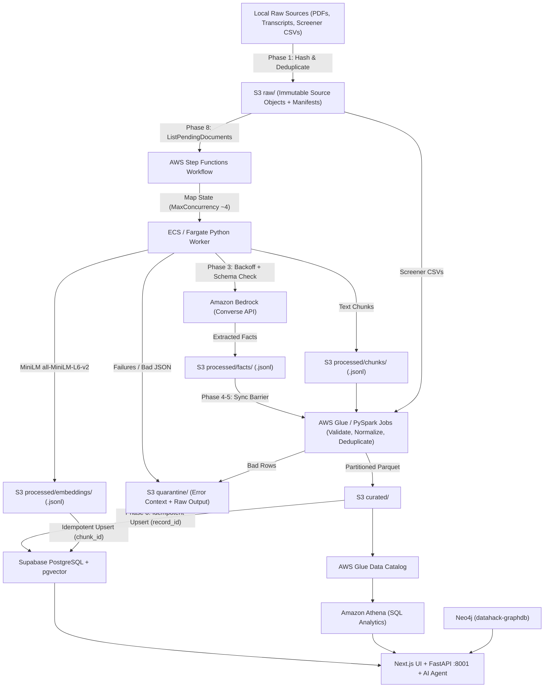

# EquityLens AI — AWS Cloud Lakehouse Implementation Plan

> **Baseline Context:** Based on the end-to-end codebase audit in [architecture_audit.md](ARCHITECTURE_AUDIT.md) and your target architecture diagram below, this plan upgrades **EquityLens AI** into a reliable, idempotent, cloud-native Medallion pipeline on AWS while keeping existing local workflows operational until each phase is verified.

---

## A. Target Architecture Recap



### Component Responsibilities

| Component | Responsibility |
|---|---|
| **S3 Raw** | Stores original PDFs, transcripts, and Screener CSVs. |
| **Step Functions** | Coordinates document processing, bounded parallel workers (`Map` state), synchronization barriers, and retries. |
| **ECS / Fargate** | Executes containerized Python extraction and embedding workers. |
| **Amazon Bedrock** | Performs LLM-based financial fact extraction, replacing Featherless AI. |
| **MiniLM** | Generates 384-dim embeddings (`all-MiniLM-L6-v2`) for RAG; retained inside the extraction worker initially. |
| **S3 Processed** | Stores extracted JSON/JSONL chunks, structured facts, embeddings, and intermediate Screener outputs. |
| **Glue + PySpark** | Cleans, normalizes, validates, deduplicates, and transforms structured datasets locally and in AWS Glue. |
| **S3 Curated** | Stores cleaned, partitioned Parquet datasets for analytics and downstream sync. |
| **Glue Data Catalog** | Stores metadata and table schemas for the Parquet tables in S3 Curated. |
| **Amazon Athena** | Queries curated Parquet datasets using serverless SQL. |
| **Supabase** | Remains the application's relational and `pgvector` serving database. |
| **Neo4j** | Remains responsible for knowledge graph relationships and traversal. |

### What Changes vs. What Stays

| Layer / Capability | Current Implementation | Target Cloud Implementation | Status |
|---|---|---|---|
| **Raw File Storage** | Local `Raw Data Extraction/` & `data/files/` | `s3://<bucket>/raw/` with content-hash manifests | **Changes** |
| **Extraction LLM** | Featherless AI (`google/gemma-3-27b-it`) in [gemma_extractor.py](file:///D:/Projects/equity-lens/pdf%20extraction%20pipeline/gemma_extractor.py) | Amazon Bedrock (`converse` API) behind `LLMProvider` abstraction | **Changes** |
| **Worker Compute & Concurrency** | Local sequential scripts (`MAX_WORKERS = 1`) in [ingest_all.py](file:///D:/Projects/equity-lens/pdf%20extraction%20pipeline/ingest_all.py) / [run_pipeline.py](file:///D:/Projects/equity-lens/pdf%20extraction%20pipeline/run_pipeline.py) | ECS / Fargate worker containers orchestrated via Step Functions `Map` (bounded concurrency) | **Changes** |
| **Intermediate & Fact Persistence** | Direct non-idempotent `INSERT` into Supabase | Write deterministic JSONL to `s3://<bucket>/processed/`, curate via PySpark/Glue, then idempotent sync | **Changes** |
| **Data Cleaning, Validation & Analytical ETL** | Ad-hoc pandas/Node scripts ([upload_screener_data.py](file:///D:/Projects/equity-lens/misc/data-gathering/upload_screener_data.py), [deviation_computer.py](file:///D:/Projects/equity-lens/pdf%20extraction%20pipeline/deviation_computer.py)) | PySpark ETL (local dev/test) + AWS Glue jobs -> Parquet in `s3://<bucket>/curated/` | **Changes** |
| **Analytical SQL** | Local CSV reads (`agent/data_loader.py`, `scripts/*.py`) | Glue Data Catalog + Amazon Athena SQL | **Added** |
| **Embeddings Model** | Local `sentence-transformers` (`all-MiniLM-L6-v2`, 384-dim) in [embedder.py](file:///D:/Projects/equity-lens/pdf%20extraction%20pipeline/embedder.py) | Same `all-MiniLM-L6-v2` (384-dim) baked into ECS worker image -> `processed/embeddings/` -> Supabase | **Stays (Relocated)** |
| **Operational DB & RAG Vector Store** | Supabase PostgreSQL + `pgvector` (12 tables + `match_documents`) | Supabase PostgreSQL + `pgvector`, fed by validated idempotent upserts | **Stays (Hardened)** |
| **Knowledge Graph** | Neo4j (`datahack-graphdb`) + [graph/api.py](file:///D:/Projects/equity-lens/graph/api.py) | Neo4j (`datahack-graphdb`) + FastAPI `:8001` | **Stays** |
| **UI, APIs & AI Agent** | Next.js 16 ([ui/](file:///D:/Projects/equity-lens/ui)), FastAPI `:8001`, [agent/agent.py](file:///D:/Projects/equity-lens/agent/agent.py) | Same serving stack (optional Phase 9 upgrades for Athena SQL tool & S3 presigned PDFs) | **Stays** |

### End-to-End Target Flow



---

## B. Guiding Principles

1. **Additive, Non-Breaking Isolation:** All new cloud modules live under a new top-level `cloud/` package. Existing pipelines in [pdf extraction pipeline/](file:///D:/Projects/equity-lens/pdf%20extraction%20pipeline), [agent/](file:///D:/Projects/equity-lens/agent), [graph/](file:///D:/Projects/equity-lens/graph), and [ui/](file:///D:/Projects/equity-lens/ui) keep running untouched by default.
2. **Feature-Flagged Dual Mode:** Behavior switches cleanly via environment variables so legacy and cloud paths remain testable side-by-side:
   - `STORAGE_BACKEND=local|s3`
   - `LLM_PROVIDER=featherless|bedrock`
   - `SINK=supabase|s3`
3. **Local-to-Cloud Parity:** The exact same Python extraction workers and PySpark ETL scripts run locally (against a local `./local_datalake/` directory or S3) and on ECS / AWS Glue.
4. **End-to-End Determinism & Idempotency:** Every document, chunk, and extracted record carries a deterministic SHA-256 identifier (`doc_id`, `chunk_id`, `record_id`) so re-runs never duplicate data.
5. **Zero Secrets in Source Control:** No API keys, JWTs, or database passwords in code or config files—use `.env` locally (gitignored) and **AWS Secrets Manager** in ECS / Glue.

---

## C. Key Architectural Decisions (Proposed Defaults)

> [!IMPORTANT]
> Please confirm or adjust these proposed defaults before Phase 0 begins:

1. **Canonical 5th Company ID = `JUNIPER` (`ITCHOTELS` as Alias):**
   - As documented in [architecture_audit.md](ARCHITECTURE_AUDIT.md), [Data Ingestion/extract_pdfs_to_json.py](file:///D:/Projects/equity-lens/Data%20Ingestion/extract_pdfs_to_json.py) maps `Juniper_Hotels` -> `ITCHOTELS` (so [Data Ingestion/extracted_json/ITCHOTELS/](file:///D:/Projects/equity-lens/Data%20Ingestion/extracted_json/ITCHOTELS/annual_report.json) actually contains Juniper Hotels filings), while [config.py](file:///D:/Projects/equity-lens/pdf%20extraction%20pipeline/config.py), [upload_screener_data.py](file:///D:/Projects/equity-lens/misc/data-gathering/upload_screener_data.py), `agent/`, and `ui/` all use `JUNIPER`.
   - **Default:** Standardize on `JUNIPER` in `cloud/common/companies.py` with an explicit alias map (`"ITCHOTELS": "JUNIPER"`, `"Juniper_Hotels": "JUNIPER"`), and seed `JUNIPER` in Supabase `companies`.
2. **AWS Region & Single Lakehouse Bucket:**
   - **Default:** `ap-south-1` (Mumbai) for low latency to Indian market data and Supabase, using one bucket `equity-lens-datalake-<account>-<env>` segmented by medallion prefixes. *(Note: if a chosen Bedrock model is unavailable in `ap-south-1`, `BEDROCK_REGION` can be configured independently, e.g., `us-east-1` / `us-west-2`.)*
3. **Python Runtime & Local Spark Toolchain:**
   - System Python is currently `3.13.2`, which is incompatible with PySpark `3.5.x` / AWS Glue `5.0` (which runs Spark `3.5` on **Python 3.11**).
   - **Default:** Create a dedicated **Python 3.11** virtual environment (`.venv-cloud/`) for `cloud/` and PySpark, paired with Java 11 or 17 for local Spark execution.
4. **Amazon Bedrock Invocation via `boto3` Converse API:**
   - **Default:** Use `bedrock-runtime` `converse()` so prompt formatting and retry logic stay model-agnostic. Configure `BEDROCK_MODEL_ID` via env var, defaulting to a Gemma 3 27B Bedrock model ID if enabled in your account/region, with verified fallback candidates (e.g., `meta.llama3-3-70b-instruct-v1:0` or Amazon Nova Pro) checked in Phase 3.
5. **Infrastructure as Code (IaC):**
   - **Recommended Default:** **AWS CDK (Python)** in `cloud/infra/` so infrastructure stays in the same language as the data engineering stack (vs. Terraform HCL).
6. **Embeddings Compute Placement:**
   - **Default:** Generate 384-dim `all-MiniLM-L6-v2` embeddings inside the ECS worker container (model cached in the Docker image at build time), write vectors to `processed/embeddings/*.jsonl`, and sync to Supabase `document_chunks` in Phase 6.

---

## D. S3 Data Lake Layout & Deterministic IDs

### Bucket Prefix Structure (`s3://equity-lens-datalake-<account>-<env>/`)

```text
raw/source=<pdf|transcript_json|screener_csv>/company=<ID>/doc_type=<...>/period=<...>/<sha256_12>__<filename>
processed/chunks/company=<ID>/doc_type=<...>/<doc_id>.jsonl
processed/embeddings/company=<ID>/<doc_id>.jsonl
processed/facts/table=<financials|guidance_claims|risk_flags|credit_ratings|raw_data>/company=<ID>/<doc_id>.jsonl
processed/screener/company=<ID>/<file>.jsonl
curated/<table>/company_id=<ID>/period_type=<...>/part-*.parquet
quarantine/<stage>/<doc_id>/{input_ref.json,error.json,raw_llm_output.txt}
manifests/documents/<doc_id>.json
athena-results/
```

### Manifest Schema (`manifests/documents/<doc_id>.json`)

Tracks document lifecycle state across S3, ECS, and Step Functions:
- `doc_id` (full SHA-256 of raw file bytes)
- `company_id`, `source_type`, `doc_type`, `period`, `raw_s3_uri`, `filename`
- `status`: `raw` | `processing` | `processed` | `failed`
- `attempts`: integer retry counter
- `content_sha256`, `error_message`, `created_at`, `updated_at`

### Deterministic Primary Keys

| Entity | Deterministic Hash Formula | Purpose |
|---|---|---|
| Document | `doc_id = sha256(file_bytes)` | Prevents duplicate S3 uploads and re-processing unchanged files. |
| Text Chunk / Embedding | `chunk_id = sha256(f"{doc_id}\|{chunk_index}")` | Enables idempotent upsert into `document_chunks` and Parquet dedup. |
| Extracted Fact / Financial Row | `record_id = sha256(f"{company_id}\|{table}\|{normalized_key_fields}")` | Enables PySpark window deduplication (`latest wins`) and Supabase `ON CONFLICT (record_id)`. |

---

## E. Phased Implementation Roadmap

### Phase 0 — Foundation & Repository Hygiene
- **Deliverables:**
  - Scaffold `cloud/` package: `common/`, `ingest/`, `worker/`, `glue_jobs/`, `sync/`, `athena/`, `stepfunctions/`, `infra/`, `tests/`, plus `cloud/requirements.txt`, `cloud/.env.example`, and `cloud/README.md`.
  - Add `Raw Data Extraction/` and `local_datalake/` to [.gitignore](file:///D:/Projects/equity-lens/.gitignore); download/place the dataset locally per [misc/notes/dataset.txt](file:///D:/Projects/equity-lens/misc/notes/dataset.txt).
  - Create `cloud/common/config.py` (central env-driven settings) and `cloud/common/companies.py` (canonical 5-company registry + alias normalization).
  - Remove/externalize hardcoded API keys/JWTs in [upload_screener_data.py](file:///D:/Projects/equity-lens/misc/data-gathering/upload_screener_data.py), [misc/data_formatter/](file:///D:/Projects/equity-lens/misc/data_formatter/ingest_engine.py), and [extract.py](file:///D:/Projects/equity-lens/misc/one-offs/extract.py), and externalize hardcoded Windows paths in [extract_pdfs_to_json.py](file:///D:/Projects/equity-lens/Data%20Ingestion/extract_pdfs_to_json.py). *(Rotate the previously committed Supabase `service_role`, Featherless, and Groq keys.)*
  - Local environment setup: Python 3.11 venv, AWS CLI v2 (`aws configure`), Docker Desktop.
- **Exit Criteria:** `python -m cloud.common.config` prints resolved configuration without errors; `pytest cloud/tests` passes baseline unit tests for config and company alias resolution.

### Phase 1 — S3 Raw Ingestion & Manifest Tracking
- **Deliverables:**
  - `cloud/common/storage.py`: Unified `StorageBackend` interface with `LocalStorage` (mirrors S3 prefix tree under `./local_datalake/`) and `S3Storage` (`boto3`).
  - `cloud/common/hashing.py`: Streaming SHA-256 helpers for `doc_id`, `chunk_id`, and `record_id`.
  - `cloud/common/manifest.py`: Read/write/transition manifest JSON objects (`raw` -> `processing` -> `processed` / `failed`).
  - `cloud/ingest/upload_raw.py`: Walks `Raw Data Extraction/`, classifies `source`, `company`, `doc_type`, and `period` (reusing period parsing logic from [ingest_all.py](file:///D:/Projects/equity-lens/pdf%20extraction%20pipeline/ingest_all.py) and [extract_pdfs_to_json.py](file:///D:/Projects/equity-lens/Data%20Ingestion/extract_pdfs_to_json.py)), checks existing `manifests/documents/<doc_id>.json`, and uploads only new/changed files.
- **Exit Criteria:** Running `upload_raw.py` twice in a row (first locally, then against S3 `raw/`) uploads `0` new objects on the second run.

### Phase 2 — Worker Refactor (`processed/` Outputs)
- **Deliverables:**
  - `cloud/worker/process_document.py`: Single-document entrypoint taking `--doc-id` (or S3 URI + manifest), reusing [pdf_extractor.py](file:///D:/Projects/equity-lens/pdf%20extraction%20pipeline/pdf_extractor.py) (`process_annual_report`), [transcript_parser.py](file:///D:/Projects/equity-lens/pdf%20extraction%20pipeline/transcript_parser.py) (`process_transcript`), and [ingest_all.py](file:///D:/Projects/equity-lens/pdf%20extraction%20pipeline/ingest_all.py) (`json_transcript_to_chunks`).
  - Refactor [gemma_extractor.py](file:///D:/Projects/equity-lens/pdf%20extraction%20pipeline/gemma_extractor.py) to accept an optional sink abstraction (`SINK=supabase|s3`) so `route_to_supabase()` becomes optional without breaking existing CLI flags.
  - Refactor embedding generation to reuse [embedder.py](file:///D:/Projects/equity-lens/pdf%20extraction%20pipeline/embedder.py) model loading (`all-MiniLM-L6-v2`) and emit JSONL records with deterministic `chunk_id`s.
  - Write outputs to `processed/chunks/`, `processed/embeddings/`, and `processed/facts/` via `StorageBackend`, and update document manifest status.
- **Exit Criteria:** One IHCL Annual Report runs end-to-end locally with `STORAGE_BACKEND=local` and `SINK=s3`, producing valid JSONL files in `processed/` and updating the manifest to `processed`.

### Phase 3 — Amazon Bedrock Integration & Quarantine Handling
- **Deliverables:**
  - `cloud/common/llm.py`: `LLMProvider` protocol with `FeatherlessProvider` (existing OpenAI SDK client) and `BedrockProvider` (`boto3.client("bedrock-runtime").converse(...)`), switched via `LLM_PROVIDER=featherless|bedrock`.
  - Wire [gemma_extractor.py](file:///D:/Projects/equity-lens/pdf%20extraction%20pipeline/gemma_extractor.py) (`get_llm_client` / `call_gemma` internals) to delegate to `LLMProvider`.
  - Implement exponential backoff + full jitter on Bedrock throttling (`ThrottlingException`, HTTP `429`/`503`).
  - Add strict JSON schema validation (Pydantic models per table: `financials`, `guidance_claims`, `risk_flags`, `credit_ratings`, `raw_data`); route unparseable LLM payloads or invalid items to `quarantine/extraction/<doc_id>/`.
- **Exit Criteria:** The same IHCL document runs end-to-end with `LLM_PROVIDER=bedrock`, producing schema-validated `processed/facts/` comparable to the Featherless baseline, and malformed synthetic responses route cleanly to `quarantine/`.

### Phase 4 — PySpark Local Transformation & Data Validation
- **Deliverables:**
  - `cloud/glue_jobs/lib/`: Shared `StructType` schemas, data quality checks (non-null keys, valid `company_id`, allowed enums, numeric range guards), and deterministic `record_id` deduplication (`Window.partitionBy("record_id").orderBy(col("ingested_at").desc())`).
  - `cloud/glue_jobs/curate_financials.py`: Ports Screener CSV parsing and metric maps (`PL_METRIC_MAP`, `BS_METRIC_MAP`, YoY/growth/margin ratios) from [upload_screener_data.py](file:///D:/Projects/equity-lens/misc/data-gathering/upload_screener_data.py) + merges `HOTEL_OPS_METRIC` rows from `processed/facts/table=financials/` -> `curated/financials/` Parquet.
  - `cloud/glue_jobs/curate_facts.py`: Cleans, normalizes periods (`FY24`, `Q2 FY25`), validates, and deduplicates `guidance_claims`, `risk_flags`, `credit_ratings`, and `raw_data` -> `curated/<table>/` Parquet (invalid rows sent to `quarantine/curation/`).
  - `cloud/glue_jobs/curate_chunks.py`: Deduplicates chunk metadata (`chunk_id`) -> `curated/document_chunks/` Parquet (metadata without heavy vector blobs for Athena, keeping vectors in `processed/embeddings/`).
  - `cloud/glue_jobs/compute_deviations.py`: Ports "Said vs Delivered" matching logic from [deviation_computer.py](file:///D:/Projects/equity-lens/pdf%20extraction%20pipeline/deviation_computer.py) into Spark joins (`guidance_claims` x `financials`) -> writes `curated/deviation_tracker/` and `curated/credibility_scores/` Parquet.
  - `cloud/glue_jobs/run_local.py`: Local Spark runner executing all jobs sequentially on `./local_datalake/`.
- **Exit Criteria:** `pytest` suite passes on sample Screener CSVs and JSONL facts; Spark outputs readable partitioned Parquet datasets under `local_datalake/curated/`.

### Phase 5 — AWS Glue, Glue Data Catalog & Amazon Athena
- **Deliverables:**
  - Adapt `cloud/glue_jobs/*.py` to accept AWS Glue job parameters (`awsglue.utils.getResolvedOptions` with argparse fallback for local mode).
  - IaC definitions in `cloud/infra/` creating the S3 bucket, IAM roles, Glue database (`equity_lens`), Glue ETL job definitions (Glue `5.0`, `G.1X`, 2 workers), and Athena workgroup pointing to `s3://<bucket>/athena-results/`.
  - `cloud/athena/ddl/*.sql`: Explicit external table / partition projection DDL for all curated Parquet tables (preferring deterministic DDL over slow Glue Crawlers, with crawler config optional).
  - `cloud/athena/queries/*.sql`: Reference analytical SQL queries (cross-company financial comparison, guidance hit rate, consecutive deviation patterns, risk severity breakdown).
- **Exit Criteria:** Glue jobs complete successfully in AWS on uploaded `processed/` + Screener `raw/` data; Athena queries return accurate rows across all 5 companies (`IHCL`, `CHALET`, `LEMONTREE`, `EIH`, `JUNIPER`).

### Phase 6 — Validated Idempotent Sync to Supabase (Serving Layer)
- **Deliverables:**
  - `cloud/sql/001_idempotency.sql`: Migration adding `record_id TEXT UNIQUE` / `chunk_id TEXT UNIQUE` columns (plus indexes) to `financials`, `guidance_claims`, `risk_flags`, `credit_ratings`, `raw_data`, `deviation_tracker`, and `document_chunks`, and inserting `JUNIPER` into `companies`.
  - `cloud/sync/supabase_sync.py`: Reads `curated/*` Parquet tables (via `pyarrow`/`awswrangler`) and `processed/embeddings/*.jsonl`, executes batched `upsert(..., on_conflict="record_id" / "chunk_id")`.
  - Optimize [scorecard_computer.py](file:///D:/Projects/equity-lens/pdf%20extraction%20pipeline/scorecard_computer.py) (cache peer metrics once across companies to eliminate the `O(N^2)` query pattern) and run post-sync to populate `scorecards`.
  - Keep Neo4j (`graph/migrate_to_neo4j.py`, `graph-db/main.py`) unchanged for now (future enhancement can feed `graph/build_graph.py` from `curated/document_chunks/`).
- **Exit Criteria:** Running `supabase_sync.py` twice in a row leaves row counts identical across all Supabase tables; the existing Next.js dashboard (`/`, `/report`, `/board`) renders live data with zero regressions.

### Phase 7 — Containerization & ECS / Fargate Execution
- **Deliverables:**
  - `cloud/worker/Dockerfile`: Based on `python:3.11-slim`, installs system PDF libs + `cloud/requirements.txt`, pre-downloads `all-MiniLM-L6-v2` into the image cache so tasks start fast with zero HuggingFace runtime downloads.
  - ECR repository + ECS Cluster + Fargate Task Definition (`cloud/infra/`) with least-privilege IAM Task Role (S3 prefix read/write, Bedrock `InvokeModel`, Secrets Manager read for Supabase credentials, CloudWatch Logs).
- **Exit Criteria:** Triggering a single `aws ecs run-task` overrides `--doc-id` and writes valid `processed/` artifacts and updated manifest to S3, visible in CloudWatch Logs.

### Phase 8 — AWS Step Functions Parallel Orchestration
- **Deliverables:**
  - `cloud/stepfunctions/document_pipeline.asl.json`:
    1. `ListPendingDocuments` (Lambda or lightweight ECS task listing `manifests/documents/` with `status in [raw, failed]`).
    2. `ProcessDocumentsMap` (`Map` state with `MaxConcurrency = 4` to respect Bedrock TPM/RPM quotas), invoking `arn:aws:states:::ecs:runTask.sync` per document, wrapped with `Retry` (exponential backoff, `MaxAttempts: 3`) and `Catch` -> `MarkQuarantined`.
    3. **Synchronization Barrier:** Once `ProcessDocumentsMap` finishes, sequentially/parallel-safely invoke `glue:startJobRun.sync` for `curate_financials`, `curate_facts`, `curate_chunks` -> `compute_deviations` -> `supabase_sync` ECS task -> `scorecard_computer` ECS task.
  - Optional S3 EventBridge rule or scheduled EventBridge trigger for automated runs.
- **Exit Criteria:** End-to-end Step Functions execution processes a multi-company batch; simulated single-document failures are caught/quarantined without aborting healthy sibling documents.

### Phase 9 — Application Integration (Optional Post-Core Upgrade)
- **Deliverables:**
  - Add an Athena SQL tool (`pyathena` / `boto3`) to [agent/tool_registry.py](file:///D:/Projects/equity-lens/agent/tool_registry.py) and [agent/prompts.py](file:///D:/Projects/equity-lens/agent/prompts.py) so the AI Agent can query `curated/` SQL tables instead of local CSVs only.
  - Update [ui/src/app/api/data/source/route.ts](file:///D:/Projects/equity-lens/ui/src/app/api/data/source/route.ts) / `/api/pdf` to return short-lived S3 presigned URLs for PDFs stored in `s3://<bucket>/raw/`.
  - Route [worflow_news/news_pipeline.py](file:///D:/Projects/equity-lens/worflow_news/news_pipeline.py) output to `s3://<bucket>/raw/source=news/` and fix the JSON key mismatch in [upload_news_to_supabase.py](file:///D:/Projects/equity-lens/worflow_news/upload_news_to_supabase.py).

---

## F. Reliability & Idempotency Matrix

| Stage | Duplicate Detection | Retry Strategy | Failure Handling & Quarantine | Idempotency Guarantee |
|---|---|---|---|---|
| **1. Raw Ingestion** | Streaming SHA-256 (`doc_id`) checked against `manifests/documents/<doc_id>.json` | `boto3` adaptive retries on S3 transient 5xx | Logs skipped/corrupt local paths to run summary; exits non-zero only on S3 auth failure | Content-addressed key `<sha256_12>__<filename>` + manifest lookup = 0 duplicate uploads |
| **2. ECS Extraction (Bedrock + MiniLM)** | Skips docs whose manifest `status == "processed"` unless `--force` | Exponential backoff + jitter (`Retry` on Bedrock `ThrottlingException` / 429; Step Functions `MaxAttempts: 3`) | Schema validation errors / unparseable LLM JSON written to `quarantine/extraction/<doc_id>/`; manifest set to `failed` | Overwrites deterministic `<doc_id>.jsonl` keyed by `chunk_id` / `record_id` |
| **3. PySpark / Glue Curation** | Window deduplication by `record_id` / `chunk_id` keeping latest `ingested_at` | Glue job retry (`MaxRetries: 1`) + Step Functions `Retry` | Records failing DQ assertions (null keys, invalid `company_id`, out-of-range ratios) split into `quarantine/curation/` | Partition overwrite (`dynamic` partition overwrite mode) per `company_id` / `period_type` |
| **4. Supabase Sync** | Batched `UPSERT` (`on_conflict="record_id"` / `"chunk_id"`) | Chunked batch retry (`batch_size=200`) on PostgREST HTTP 5xx/429 | Failed batches logged with batch offset & written to `quarantine/sync/` | Unique constraint on `record_id` / `chunk_id` guarantees identical row counts on re-run |
| **5. Step Functions Orchestration** | `ListPendingDocuments` filters out `status == "processed"` | Per-state `Retry` with `BackoffRate: 2.0` | `Catch` transitions failing branch to `MarkFailed`, allowing sibling `Map` items to succeed; CloudWatch Alarm on execution failure | Safe to re-drive failed executions from Step Functions console |

---

## G. Branch & Merge Strategy

1. **Active Feature Branch:** All AWS upgrade work happens on `feat/aws-cloud-pipeline` (branched from `main` at `b8013bb`).
2. **Commit Cadence:** Commit per completed phase (`feat(cloud): phase N - ...`) with unit/integration tests passing before moving to the next phase.
3. **Zero Regression on `main`:** Legacy local/Featherless/Supabase defaults remain intact until Phase 6 passes end-to-end validation.
4. **Merge to `main`:** Rebase `feat/aws-cloud-pipeline` onto `main`, verify both legacy tests and `cloud/tests/` pass, then merge via PR/fast-forward.

---

## H. Cost & Quota Guardrails

- **AWS Glue:** Billed per DPU-minute (minimum 1-minute billing per Spark job). Use **Glue 5.0 with `G.1X` and `NumberOfWorkers = 2`** during dev/testing, and batch tables inside single jobs rather than spinning up dozens of micro-jobs.
- **Amazon Athena:** Billed per TB scanned (`$5` / TB). Storing `curated/` as **Snappy-compressed Parquet** partitioned by `company_id` reduces scans on 5 hotel companies to kilobytes/megabytes.
- **ECS / Fargate:** Billed per vCPU-second and GB-second. Keep `Map` `MaxConcurrency` bounded (`~4`), bake `all-MiniLM-L6-v2` into the Docker image, and use Fargate Spot for non-urgent batch backfills.
- **Amazon Bedrock:** Token-based billing + per-account RPM/TPM quotas. Retain `is_high_signal_chunk()` pre-filtering and `CHUNKS_PER_BATCH = 5` from [gemma_extractor.py](file:///D:/Projects/equity-lens/pdf%20extraction%20pipeline/gemma_extractor.py) to avoid sending boilerplate pages to Bedrock.
- **Billing Safety:** Configure an **AWS Budget Alarm** (e.g., `$10` / `$25` monthly alert) in Phase 0 before launching Glue/ECS runs.

---

## I. Open Questions Before Starting Phase 0

1. **IaC Tooling:** Do you prefer **AWS CDK (Python)** (recommended to match the Python/PySpark codebase) or **Terraform** in `cloud/infra/`?
2. **AWS Account & Bedrock Readiness:** Which AWS region will you deploy to (`ap-south-1` Mumbai vs `us-east-1`), and have you checked which Bedrock foundation models (Gemma / Llama / Nova) are enabled in your AWS account? *(Note: AWS CLI v2 and Docker Desktop are not yet installed on this machine.)*
3. **5th Company Canonical ID:** Can you confirm standardizing on `JUNIPER` everywhere and treating `ITCHOTELS` in [Data Ingestion/extracted_json/ITCHOTELS/](file:///D:/Projects/equity-lens/Data%20Ingestion/extracted_json/ITCHOTELS/annual_report.json) as an alias for Juniper Hotels?
4. **News Pipeline Scope:** Should [worflow_news/](file:///D:/Projects/equity-lens/worflow_news/news_pipeline.py) be included in the S3/Athena upgrade in Phase 9, or stay standalone for now?
